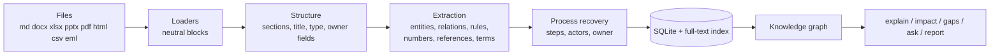

# DocReverse

**Reverse-engineer company documents into a queryable model of how the organisation actually works.**


DocReverse reads policies, SOPs, runbooks, spreadsheets, slide decks, web pages and e-mails, and rebuilds the operating model they describe: **who does what, in which system, in what order, under which rules**, and **where the documents contradict each other or leave gaps**.

- Runs **locally** on the Python standard library. No server, no cloud, no API key needed.
- Reads `.txt .md .rst .log .html .csv .docx .xlsx .pptx .eml .pdf`
- Builds a **knowledge graph** you can query, trace and export.
- Every finding keeps the **sentence it came from**, so it can be checked.
- Optional AI layer for written answers, with sensitive data redacted first.

## Contents

- [Why](#why)
- [What you get](#what-you-get)
- [Example](#example)
- [Installation](#installation)
- [Quick start](#quick-start)
- [Commands](#commands)
- [How it works](#how-it-works)
- [Using it on your own documents](#using-it-on-your-own-documents)
- [Optional AI mode](#optional-ai-mode)
- [Project structure](#project-structure)
- [Testing](#testing)
- [Limitations](#limitations)
- [Privacy](#privacy)
- [Extending](#extending)
- [Roadmap](#roadmap)
- [Contributing](#contributing)
- [License](#license)

## Why

Knowledge about how a company runs is scattered across documents written by different people at different times. Nobody holds the whole picture, so you get processes with no owner, a policy that says 3 days while the procedure says 5, references to documents that no longer exist, and systems everyone uses but nobody has documented. DocReverse turns that pile into something you can ask questions of.

## What you get

| You ask | DocReverse answers from |
|---|---|
| What processes exist, and what are the steps? | Ordered lists and sequence wording under process-like headings |
| Who owns, approves or reviews what? | Sentence analysis into (subject, verb, object) relations |
| Which systems are used, and by whom? | Tool-name detection and `uses` relations |
| What is affected if SAP changes or fails? | Graph traversal (impact analysis, both directions) |
| What is missing or inconsistent? | Gap detectors: ownerless processes, conflicting numbers, broken references, stale documents |
| How does X work? / a free-form question | Full-text search plus graph facts, optionally an AI-written answer |

## Example

Given the sentence:

```text
Employee creates the Expense Report in Concur and attaches all receipts.
```

DocReverse extracts:

```text
entities   Employee (role) · Expense Report (artifact) · Concur (system)
relations  Employee  creates  Expense Report
           Employee  uses     Concur
```

Passive voice is handled too: *"The Expense Report is approved by the Line Manager."* becomes `Line Manager approves Expense Report`.

Across documents, `gaps` reports problems like these (abridged):

```text
[WARN] conflicting_numbers: Possible conflict (business_day): 3 business days vs 5 business days for similar statements.
[WARN] broken_reference: FIN-102 Expense Reimbursement SOP references HR-204, which is not in the corpus.
```

The repository includes a small made-up company in `sample_docs/` with deliberately planted problems, and a generated report in `out/example_report.md`.

## Installation

Requires **Python 3.9 or newer**. Nothing else is needed for the core.

```bash
git clone <your-repo-url>
cd docreverse_project
```

Optional extras:

```bash
pip install pypdf        # read PDF files (or install poppler's `pdftotext`)
pip install anthropic    # AI answers and deep extraction
pip install -e .         # optional: installs a `docreverse` command
```

## Quick start

```bash
python scripts/make_samples.py              # optional: creates the .docx/.xlsx/.pptx samples
python -m docreverse ingest sample_docs     # read everything, build .docreverse/index.db
python -m docreverse status
python -m docreverse processes
python -m docreverse processes --show "Expense" --mermaid
python -m docreverse explain "Line Manager"
python -m docreverse impact Concur
python -m docreverse impact SAP --direction up
python -m docreverse gaps
python -m docreverse ask "who approves expense claims over 2500"
python -m docreverse report --out out/report.md
python -m docreverse graph --format mermaid --out out/graph.mmd
```

Re-running `ingest` is incremental: unchanged files are skipped.

## Commands

| Command | What it does | Useful options |
|---|---|---|
| `ingest PATH...` | Read files or folders and build the index | `--gazetteer FILE` `--force` `--prune` `--deep` |
| `status` | Counts of documents, processes, relations, rules, graph size | |
| `processes` | List processes, or show one in full | `--show NAME` `--mermaid` |
| `explain TOPIC` | Profile of a role, team, system, form or process | |
| `impact TOPIC` | What is affected, or what it depends on | `--direction down\|up` `--depth N` |
| `gaps` | List detected problems with evidence | `--stale-days N` |
| `ask QUESTION` | Answer a question from the documents | `--no-llm` |
| `search QUERY` | Ranked full-text search | `-k N` |
| `graph` | Export the knowledge graph | `--format mermaid\|dot\|json` `--max-nodes N` `--out FILE` |
| `report` | Write the full Markdown report | `--out FILE` |

Global option: `--db PATH` (or env var `DOCREVERSE_DB`) chooses the index file, so projects can keep separate indexes.

### Problems it detects

`ownerless_process` · `inferred_owner` · `thin_process` · `broken_reference` · `missing_document` · `undocumented_system` · `undefined_acronym` · `stale_document` · `duplicate_process` · `conflicting_numbers`

## How it works



1. **Read.** Each loader turns a file into neutral blocks (headings, paragraphs, list items, table rows, formulas, comments). Word, PowerPoint and Excel are parsed straight from their XML. Excel formulas and Word reviewer comments are kept.
2. **Structure.** Blocks are grouped into sections; the title, document code (such as `FIN-102`), document type and header fields (`Owner:`, `Last Reviewed:`) are found.
3. **Extract.** Rule-based detection of four entity kinds (role, team, system, artifact), relations from the text between entities (passive voice, conjunctions and free-text objects handled), rules (must / must not / should / may), numbers with units, cross-references and glossary terms.
4. **Recover processes.** Ordered steps become processes with an actor and systems per step, decision flags, and an owner marked *stated* or *inferred*.
5. **Store and graph.** Everything goes into one SQLite file with full-text search (BM25), then into a graph with evidence on every edge.
6. **Analyse.** Impact analysis treats *flow* edges (sends_to, approves, triggers...) as carrying impact forward and *dependency* edges (uses, depends_on, references...) as carrying it backward. People and teams are shown as affected but not chained through.

## Using it on your own documents

```bash
python -m docreverse ingest /path/to/your/documents
python -m docreverse status
python -m docreverse gaps
```

Run `status` and `gaps` first: they show quickly how well the extraction fits your writing style. If systems or roles are missed, add a vocabulary file:

```json
{
  "systems": ["Workday", "PagerDuty"],
  "roles":   ["Incident Commander"],
  "teams":   ["Security Team"],
  "aliases": {"SAP ERP": "SAP", "Service Now": "ServiceNow"}
}
```

```bash
python -m docreverse ingest /path/to/docs --gazetteer company.json
```

Treat every finding as a question to verify against the evidence sentence it shows.

## Optional AI mode

```bash
pip install anthropic
export ANTHROPIC_API_KEY=...
python -m docreverse ask "how does a vendor get approved?"
python -m docreverse ingest /path/to/docs --deep
```

- `ask` writes a cited answer from retrieved passages and graph facts. Without a key it shows the relevant passages instead.
- `ingest --deep` asks the model to extract processes, relations, rules and terms section by section, and marks them as coming from the model.
- The model name defaults to `claude-sonnet-5-5`; change it with `DOCREVERSE_MODEL`.
- Before any text is sent, e-mail addresses, phone numbers, SSNs, Luhn-valid card numbers, IBANs and key-like secrets are replaced with placeholders (best effort).

## Project structure

```text
docreverse_project/
├── docreverse/
│   ├── cli.py            command-line interface
│   ├── config.py         defaults and supported extensions
│   ├── models.py         data classes
│   ├── textutil.py       sentence splitting, stop-words, helpers
│   ├── structure.py      blocks -> sections, title, code, type, fields
│   ├── pipeline.py       analysis, chunking, file discovery, incremental ingest
│   ├── store.py          SQLite schema and full-text search
│   ├── model.py          loads the store, builds the graph
│   ├── graph.py          knowledge graph, impact analysis, exports
│   ├── analyze.py        overview, ownership, systems map, gap detectors
│   ├── qa.py             retrieval + graph facts -> answer
│   ├── report.py         Markdown report with Mermaid diagrams
│   ├── llm.py            optional AI layer
│   ├── redact.py         removes sensitive tokens before AI calls
│   ├── ingest/           text, html, office (docx/pptx/xlsx), other (csv/pdf/eml)
│   └── extract/          entities, relations, processes, rules, facts
├── tests/                32 tests and Office-file builders
├── sample_docs/          fictional company documents with planted problems
├── scripts/make_samples.py
├── docs/PROJECT_GUIDE.md detailed design guide
└── out/                  example report and graph
```

A detailed walk-through of every module is in [docs/PROJECT_GUIDE.md](docs/PROJECT_GUIDE.md).

## Testing

```bash
python -m unittest discover -s tests -t .
```

The 32 tests cover entity and relation extraction, numbers and rules, every file loader, and an end-to-end run over the sample documents (search, impact, report, redaction).

The results come from a small synthetic document set, so they show the mechanisms work, not how accurate the tool is on real company documents. No precision or recall has been measured on real data.

## Limitations

- **Heuristics, not understanding.** Expect missed and occasionally wrong relations; each shows its evidence sentence.
- **Naming.** Lowercase roles and systems are recognised only after a determiner or via the vocabulary file. A place name after "in" can be mistaken for a system.
- **Prose-only processes** with no steps or sequence words are missed (try `--deep`).
- **Conflict detection** compares sentence similarity, so it can raise false alarms or miss differently worded conflicts.
- **Spreadsheets:** formulas are searchable but not yet modelled as a dependency graph.
- **Scanned PDFs** need OCR first. English only.
- Documents describe what *should* happen, not necessarily what people do.

## Privacy

Nothing leaves your machine unless you opt in to the AI features. The index is a local file; `.docreverse/` is git-ignored. Only analyse documents you are permitted to process, and treat generated reports with the same care as the source documents, since they quote them.

## Extending

- **New file format:** write `load_xxx(path) -> (blocks, metadata)`, register it in `docreverse/ingest/__init__.py`, add the extension to `config.py`.
- **New relation verb:** add a pattern in `extract/relations.py` and the predicate to the flow or dependency set in `graph.py`.
- **New check:** add a block to `Analyzer.gaps()` in `analyze.py`.
- **Another language:** replace the role, verb and cue lists.

## Roadmap

- [ ] OCR for scanned documents
- [ ] Spreadsheet formula dependency graph
- [ ] Semantic (embedding) search alongside keyword search
- [ ] Document version diffing
- [ ] Responsibility matrix export (RACI)
- [ ] Small web interface
- [ ] Labelled evaluation set from real documents


## Author

Shayan Ponnanna Malchira
